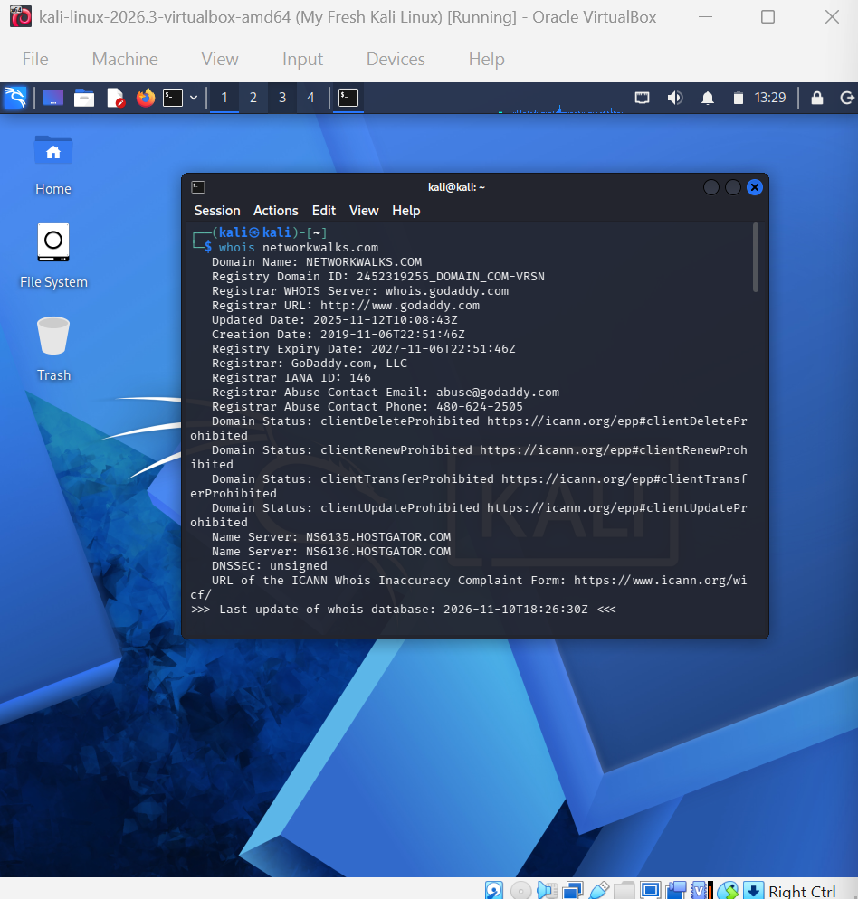
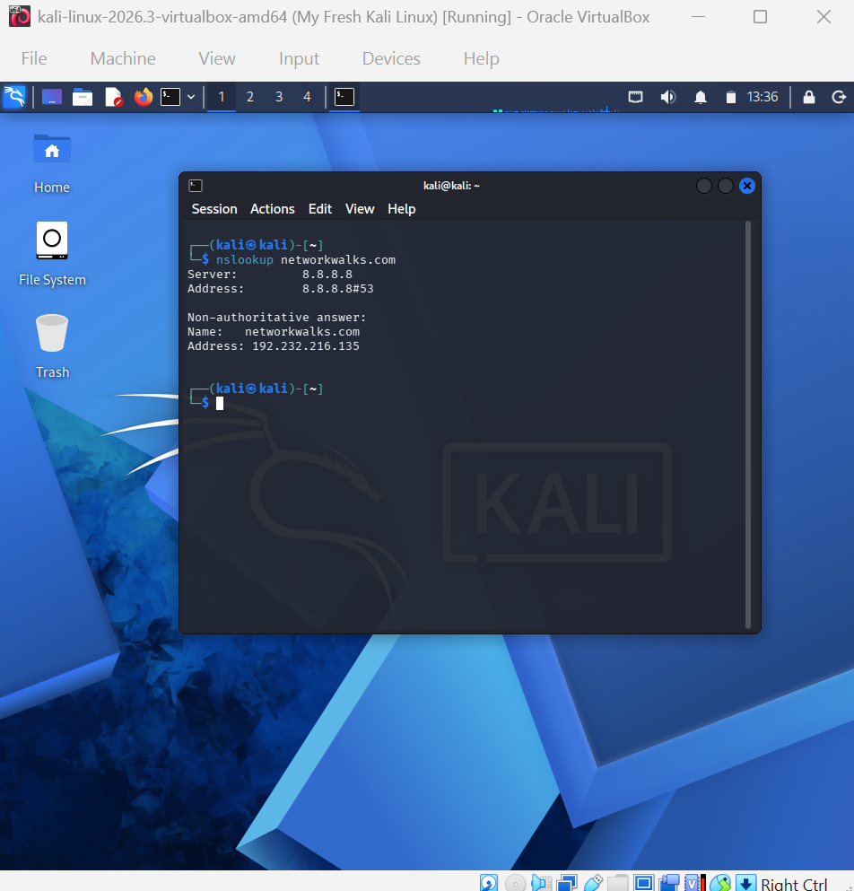
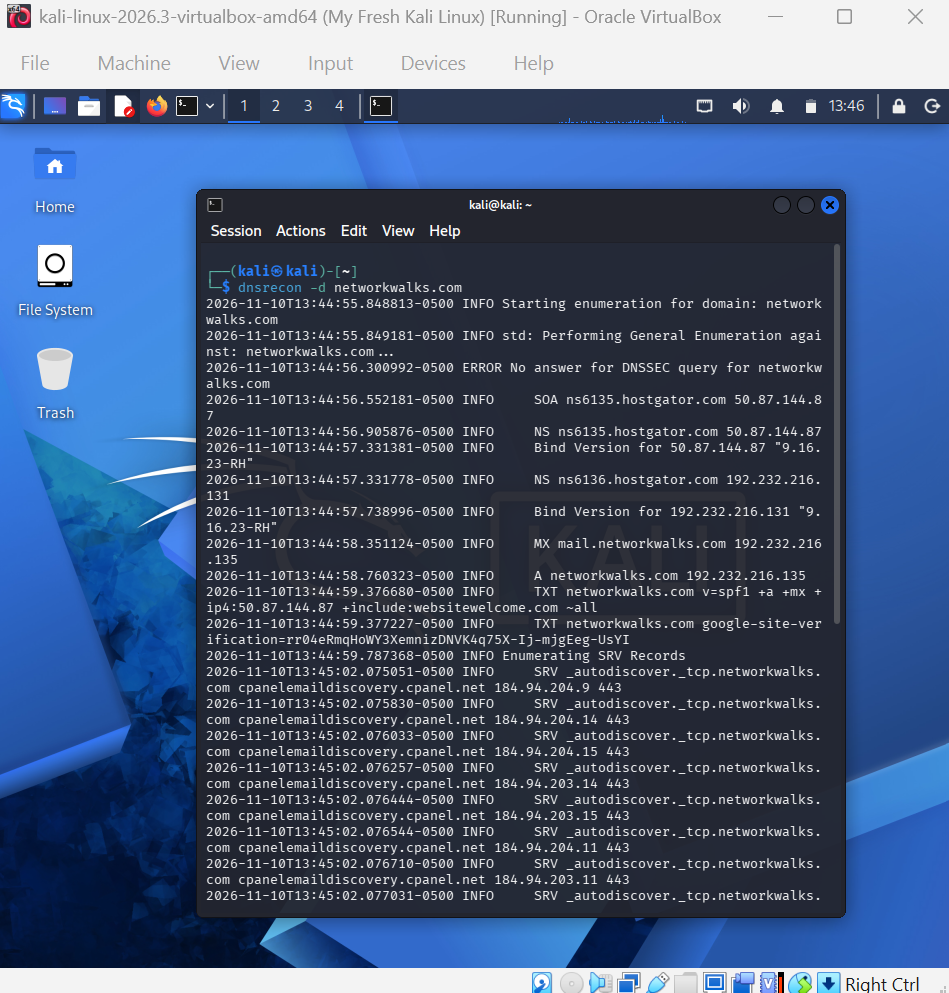
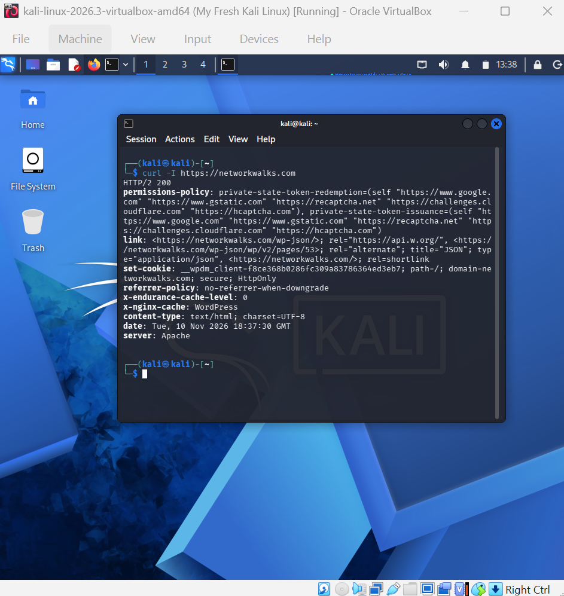
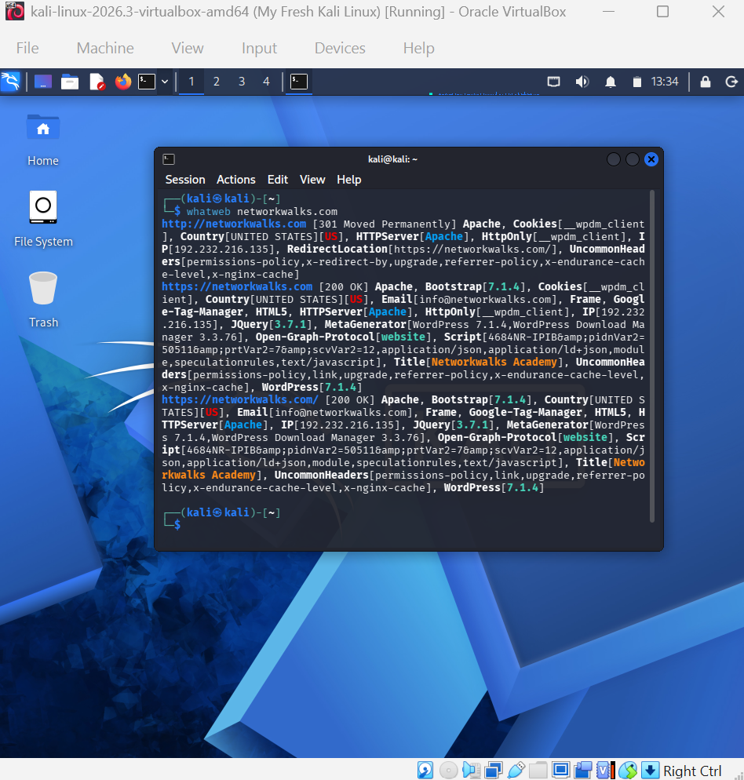
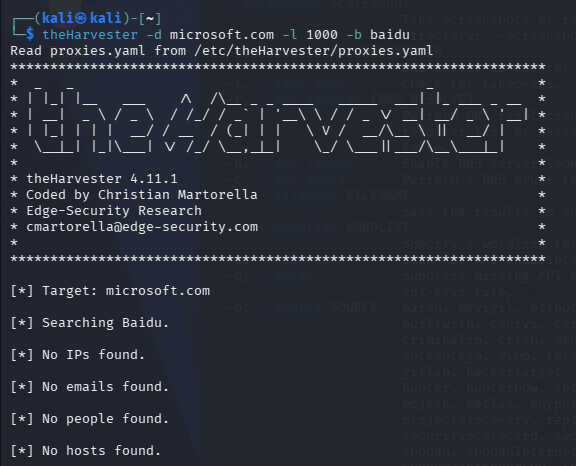
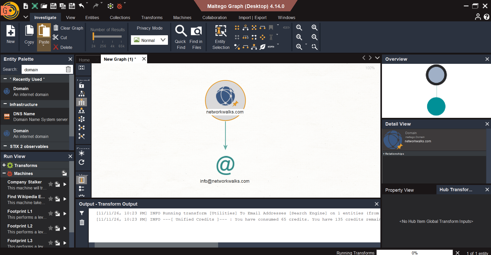
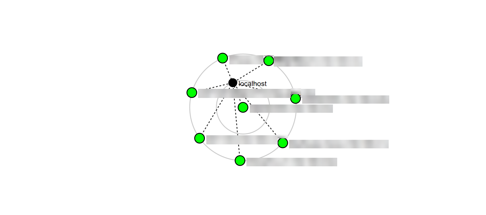

# NetworkWalks-B048-week1-Penetration-Testing-Report-Footprinting-Network-Scanning-Phases

Penetration Testing Report
    
FOOTPRINTING & NETWORK SCANNING PHASES

<table border="1" cellpadding="8" cellspacing="0">
    <thead>
        <tr>
            <th>Field</th>
            <th>Details</th>
        </tr>
    </thead>
    <tbody>
        <tr>
            <td>Pentester Name (Cybersecurity Professional)</td>
            <td>Raheela Razaq</td>
        </tr>
        <tr>
            <td>Program/Batch</td>
            <td>B084-Networkwalks</td>
        </tr>
        <tr>
            <td>Date</td>
            <td>12.11.2026</td>
        </tr>
        <tr>
            <td>Modules Completed</td>
            <td>
                W2-PM1 (Multiple Kali Tools) 
                W2-PM3 (Footprinting with Maltego) 
                W2-PM4 (Footprinting with theHarvester) 
                W2-PM5 (Zenmap Scanning)
            </td>
        </tr>
        <tr>
            <td>Client/Target</td>
            <td>
                1. Networkwalks (secured written permission already) 
                2. My own local LAN Network
            </td>
        </tr>
        <tr>
            <td>Permission Secured from Client?</td>
            <td>Yes</td>
        </tr>
        <tr>
            <td>Phases Covered</td>
            <td>
                Phase 1: Reconnaissance &amp; Footprinting 
                Phase 2: Scanning &amp; Network Discovery 
                Phase 3-5: In Progress
            </td>
        </tr>
    </tbody>
</table>

## 1. Liability Disclaimer
This report was produced for educational purposes as part of a cybersecurity learning exercise. All activities were performed from an isolated Kali Linux virtual machine. The findings reflect only the information available at the time of testing (10-11 November 2026) and should not be treated as a complete security assessment. The author accepts no liability for any use of this information beyond its educational purpose.
Authorisation and scope: This work was carried out as a security professional would, within an agreed scope and with the permission of the owners. Networkwalks authorised footprinting and reconnaissance of networkwalks.com. The theHarvester searches against microsoft.com were set tasks in the Networkwalks lab and used passive, public-source searching only. The Zenmap scan was run on the author's own home network. No testing went outside these limits.

---

## 2. Introduction
The aim of this exercise was to gather information about the target domain networkwalks.com using passive and active reconnaissance techniques. This covered domain registration, DNS records, web technologies, hosting infrastructure, and any publicly exposed contact information. The work was done from a Kali Linux 2026.3 VM running in Oracle VirtualBox.
Scope: networkwalks.com and its associated infrastructure, plus the author's own local network for the Zenmap scan.
Testing dates: 10-11 November 2026.

---

## 3. Tools Used
<table border="1" cellpadding="8" cellspacing="0">
    <thead>
        <tr>
            <th>Tool</th>
            <th>Purpose</th>
        </tr>
    </thead>
    <tbody>
        <tr>
            <td>whois</td>
            <td>Domain registration details</td>
        </tr>
        <tr>
            <td>nslookup</td>
            <td>DNS resolution (A record)</td>
        </tr>
        <tr>
            <td>dnsrecon</td>
            <td>DNS enumeration (SOA, NS, MX, TXT, SRV)</td>
        </tr>
        <tr>
            <td>curl -I</td>
            <td>HTTP response header inspection</td>
        </tr>
        <tr>
            <td>whatweb</td>
            <td>Web technology fingerprinting</td>
        </tr>
        <tr>
            <td>wafw00f</td>
            <td>Web Application Firewall detection</td>
        </tr>
        <tr>
            <td>theHarvester 4.11.1</td>
            <td>OSINT gathering of emails, hosts and IPs</td>
        </tr>
        <tr>
            <td>Maltego 4.14.0</td>
            <td>Graph-based OSINT and entity mapping</td>
        </tr>
        <tr>
            <td>Zenmap</td>
            <td>Network scanning</td>
        </tr>
    </tbody>
</table>

---

4. Activities Performed
    Footprinting & Reconnaissance
## Domain registration (whois)
The whois networkwalks.com command returned the following:
• Registrar: GoDaddy.com, LLC
• Created: 6 November 2019
• Expires: 6 November 2027
• Last updated: 12 November 2025
• Name servers: NS6135.HOSTGATOR.COM and NS6136.HOSTGATOR.COM
• DNSSEC: unsigned
• Domain status: transfer, update, delete and renew locks are enabled (client*Prohibited)

---

##  DNS resolution (nslookup)
Using Google's resolver (8.8.8.8), the domain resolved to 192.232.216.135 (non-authoritative answer).

---

## DNS enumeration (dnsrecon)
dnsrecon -d networkwalks.com revealed:
• SOA: ns6135.hostgator.com (50.87.144.87)
• NS: ns6135.hostgator.com (50.87.144.87) and ns6136.hostgator.com (192.232.216.131)
• BIND version disclosed on both name servers: 9.16.23-RH
• MX: mail.networkwalks.com (192.232.216.135)
• A: 192.232.216.135
• TXT (SPF): v=spf1 +a +mx +ip4:50.87.144.87 +include:websitewelcome.com ~all
• TXT: a Google site-verification record
• SRV: multiple _autodiscover._tcp records pointing to cpanelemaildiscovery.cpanel.net, indicating cPanel-based hosting
• Error: no answer for the DNSSEC query, consistent with the whois result

---

##  HTTP header analysis (curl)
curl -I https://networkwalks.com returned HTTP/2 200 with these notable headers:
• server: Apache
• x-nginx-cache: WordPress and x-endurance-cache-level: 0, indicating WordPress with a hosting-level cache
• A link header exposing the WordPress REST API (/wp-json/) and a JSON alternate for page ID 53
• A __wpdm_client cookie set with secure and HttpOnly flags
• referrer-policy: no-referrer-when-downgrade
• A permissions-policy header listing trusted third parties (Google, reCAPTCHA, Cloudflare, hCaptcha)

---

##  Technology fingerprinting (whatweb)
whatweb networkwalks.com showed an HTTP 301 redirect to HTTPS, followed by a 200 OK. Identified technologies:
• Apache web server
• WordPress 7.1.4
• WordPress Download Manager plugin 3.3.76
• jQuery 3.7.1
• Google Tag Manager and HTML5
• Site title "Networkwalks Academy"
• Public email address info@networkwalks.com
• IP 192.232.216.135 (United States)

## 4.1.6 WAF detection (wafw00f)
wafw00f networkwalks.com (v2.4.2) detected that the site is behind ModSecurity (SpiderLabs) WAF, using 2 requests.

4.1.7 OSINT with theHarvester
theHarvester 4.11.1 was run in two configurations:
• theHarvester -d microsoft.com -l 1000 -b baidu returned no IPs, emails, people or hosts from Baidu.
These runs were used to test the tool and learn how it behaves. They showed that theHarvester's output depends heavily on configured API keys and the choice of data source.
The lab names microsoft.com as the example target. theHarvester reads public sources and does not touch the target directly, so these searches were passive.

---

## 4.1.8 Graph-based OSINT with Maltego
In Maltego Desktop 4.14.0, networkwalks.com was added as a Domain entity. The "To Email Addresses [Search Engine]" transform found info@networkwalks.com, which matches the whatweb result. The transform consumed 65 credits, leaving 135.

---

## 4.2 Network Scanning with Zenmap (Ping Scan)
Zenmap was used to run a ping scan (host discovery) on the local network the Kali VM is connected to. A ping scan only checks which hosts are online. It does not scan ports or identify services. This is a separate target from networkwalks.com, and it is the author's own home network, so the scan was done with full authorisation. 
Observations:
• The scan found 8 live hosts, each connected directly to the VM, which is expected on a flat home network.
• Most are consumer devices: an iPhone, a laptop, a home router, a set-top box and smart-home devices.
• No host shows a padlock or other marker, because a ping scan does not test ports or services.
• Every device that answered the ping is visible to anyone on the same network, which is the main exposure shown by this scan.
Limitation: a ping scan only shows which devices are online. A follow-up port and service scan (e.g. Zenmap's Intense scan) would be needed to find open ports and software versions. Device names and IP addresses are blurred in Figure 10 and replaced with generic labels in the table above.

---

## 5. Risk Analysis / Impact
Based on the information collected during the footprinting and network scanning activities, I identified the following potential risks.
#
<table border="1" cellpadding="8" cellspacing="0" style="width:100%; border-collapse:collapse; font-family:Arial, sans-serif;">
    <thead>
        <tr style="background-color:#263b5e; color:white;">
            <th>No.</th>
            <th>Finding</th>
            <th>Risk</th>
            <th>Impact</th>
        </tr>
    </thead>
    <tbody>
        <tr>
            <td>1</td>
            <td>Software version disclosure. WordPress 7.1.4, WP Download Manager 3.3.76 and jQuery 3.7.1 are identifiable.</td>
            <td>Low-Medium</td>
            <td>An attacker can search for known vulnerabilities in these exact versions, especially in plugins.</td>
        </tr>
        <tr>
            <td>2</td>
            <td>BIND version disclosed (9.16.23-RH) on both name servers.</td>
            <td>Low</td>
            <td>Allows targeted attacks against known BIND flaws.</td>
        </tr>
        <tr>
            <td>3</td>
            <td>WordPress REST API exposed via the Link header and /wp-json/.</td>
            <td>Low</td>
            <td>Can allow enumeration of pages, posts and sometimes users.</td>
        </tr>
        <tr>
            <td>4</td>
            <td>Public email address (info@networkwalks.com).</td>
            <td>Low</td>
            <td>A target for phishing and spam campaigns.</td>
        </tr>
        <tr>
            <td>5</td>
            <td>DNSSEC not enabled.</td>
            <td>Low</td>
            <td>The domain is more exposed to DNS spoofing and cache poisoning.</td>
        </tr>
        <tr>
            <td>6</td>
            <td>SPF ends in ~all (soft fail).</td>
            <td>Low</td>
            <td>Spoofed emails from the domain may still be delivered.</td>
        </tr>
        <tr>
            <td>7</td>
            <td>Shared hosting infrastructure (HostGator/cPanel).</td>
            <td>Informational</td>
            <td>A compromise elsewhere on the shared environment could affect the site.</td>
        </tr>
        <tr>
            <td>8</td>
            <td>Missing security headers. HSTS, CSP, X-Frame-Options and X-Content-Type-Options were not seen in the response headers.</td>
            <td>Low</td>
            <td>Increases exposure to clickjacking, MIME sniffing and downgrade attacks.</td>
        </tr>
        <tr>
            <td>9</td>
            <td>Weak referrer policy (no-referrer-when-downgrade).</td>
            <td>Informational</td>
            <td>May leak full URLs to third parties over HTTPS.</td>
        </tr>
        <tr>
            <td>10</td>
            <td>Local network: 8 live devices found by the ping scan, including two that could not be identified.</td>
            <td>Low-Medium</td>
            <td>Unknown devices are harder to patch and monitor, and could be unauthorised.</td>
        </tr>
    </tbody>
</table>

<h3>Positive Security Findings</h3>

<table border="1" cellpadding="8" cellspacing="0" style="width:100%; border-collapse:collapse; font-family:Arial, sans-serif;">
    <thead>
        <tr style="background-color:#287a50; color:white;">
            <th>No.</th>
            <th>Positive Finding</th>
            <th>Security Benefit</th>
        </tr>
    </thead>
    <tbody>
        <tr>
            <td>1</td>
            <td>HTTPS enforcement with a 301 redirect.</td>
            <td>Ensures visitors are redirected to a secure HTTPS connection.</td>
        </tr>
        <tr>
            <td>2</td>
            <td>ModSecurity Web Application Firewall (WAF).</td>
            <td>Provides an additional layer of protection against common web attacks.</td>
        </tr>
        <tr>
            <td>3</td>
            <td>Secure and HttpOnly cookie flags enabled.</td>
            <td>Helps protect cookies against interception and client-side script access.</td>
        </tr>
        <tr>
            <td>4</td>
            <td>Domain transfer and update locks enabled.</td>
            <td>Helps prevent unauthorised domain transfers and unwanted changes.</td>
        </tr>
        <tr>
            <td>5</td>
            <td>Local network ping scan revealed only live devices, without service details.</td>
            <td>Network discovery was limited to identifying which devices were online.</td>
        </tr>
    </tbody>
</table>

---

## 6. Recommendations
Based on the observations from these activities, I recommend the following security improvements:
1.  Keep WordPress, plugins and libraries updated, and remove unused plugins. Hide version strings from generator tags and headers where possible.
2.  Restrict the WordPress REST API for unauthenticated users where it isn't needed, and remove the link header exposure.
3.  Enable DNSSEC through the registrar and DNS host.
4.  Tighten email authentication. Move SPF to -all once all senders are confirmed, and implement DKIM and DMARC.
5.  Use a role-based or contact-form address instead of a plain public email, and train staff to spot phishing.
6.  Maintain the WAF with up-to-date rule sets, and consider monitoring and rate limiting.
7.  Review the hosting setup. Consider a dedicated VPS or a hardened managed WordPress host.
8.  Run a port and service scan of the local network, starting with the router and set-top box, and disable services that aren't needed.

---

## 7. Conclusion
The reconnaissance of networkwalks.com showed that a significant amount of information about the target is publicly available: registration details, DNS infrastructure, hosting provider, CMS and plugin versions, and a contact email. None of the findings is critical on its own, but together they give an attacker a useful profile for planning a targeted attack. The site has some good defences, including HTTPS enforcement, a ModSecurity WAF and domain locks. The Zenmap scan of the local network was a ping scan that found 8 live devices, two of which could not be identified. Reducing version disclosure, enabling DNSSEC, strengthening email authentication, adding security headers and keeping an inventory of local devices would meaningfully reduce exposure. This exercise also showed how a combination of tools (whois, dnsrecon, whatweb, wafw00f, theHarvester, Maltego and Zenmap) builds a fuller picture than any single tool.

---
